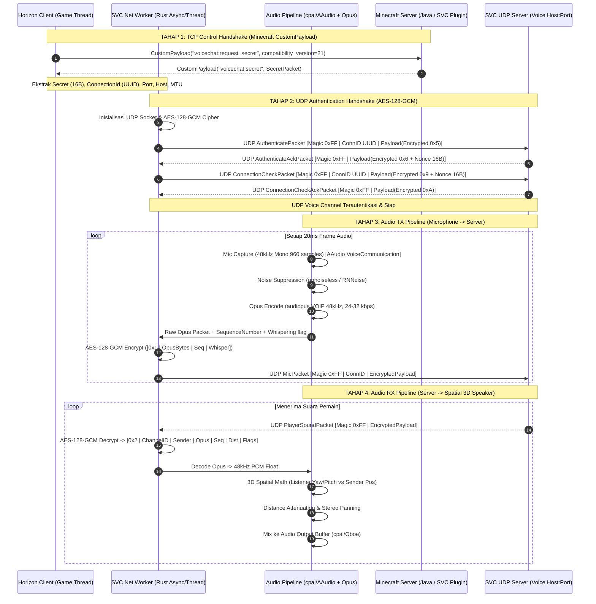
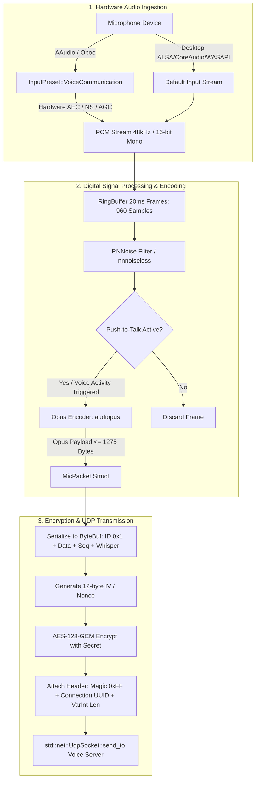

# SVC (Simple Voice Chat) Port Blueprint: Horizon Ecosystem (Desktop & Android)

Dokumen ini adalah cetak biru arsitektur komprehensif untuk mem-porting protokol dan sistem audio **Simple Voice Chat (SVC)** ke dalam ekosistem **Horizon (Rust / wgpu)**, mencakup platform **Desktop (Linux, macOS, Windows)** dan **Android**.

---

## 1. Ringkasan Eksekutif & Peta Arsitektur Lintas-Repositori

Simple Voice Chat (SVC) bekerja menggunakan arsitektur *dual-channel*:
1. **Control Channel (TCP / Minecraft `CustomPayload`)**: Menegosiasikan secret session, port UDP server, konfigurasi voice host, jarak suara, codec, dan state grup/pemain.
2. **Audio Data Channel (UDP / AES-128-GCM)**: Mengirimkan audio mic terenkripsi, sinkronisasi posisi 3D pemain, keepalive, dan ping dengan latensi ultra-rendah.

Di ekosistem **Horizon**, terdapat disparitas arsitektur antara Desktop dan Android:
- **Desktop**: Mendukung native compilation launcher (`.hnmod` mixin bundle) dan WebAssembly sandbox (`.hmod`). Native mod memiliki akses penuh ke sistem OS (`std::net::UdpSocket`, thread native).
- **Android**: Tidak memiliki native compiler C/Rust di perangkat pengguna, dan sandbox `.hmod` WebAssembly (WIT) saat ini tidak mengekspos raw UDP socket maupun raw audio capture stream. Oleh karena itu, pendekatan produksi yang optimal untuk Android adalah mengintegrasikan SVC sebagai **Built-in Client Module** (fitur native di `horizon-client` di balik feature-gate `voice-chat`) atau menyediakan **Host API Bridge**.

---

## 2. Diagram Arsitektur Graphify (Mermaid)

### 2.1. End-to-End Handshake & Audio Pipeline Sequence



### 2.2. Audio Capture & DSP Flowchart (Android & Desktop)



---

## 3. Spesifikasi Lengkap Protokol Jaringan SVC (Java -> Rust Parity)

Berdasarkan analisis AST dan kode sumber resmi Simple Voice Chat (`de.maxhenkel.voicechat`):

### 3.1. Compatibility Version & Channel Identifiers

- **`COMPATIBILITY_VERSION` saat ini**: **`21`** (Minecraft 26.3 / SVC 2.7.x).
- **Identifier Channel Minecraft CustomPayload (TCP)**:
  Semua identifier menggunakan namespace `voicechat`:

| Channel Identifier String | Tipe Paket Java | Arah Aliran | Deskripsi Singkat |
|---|---|---|---|
| `voicechat:request_secret` | `RequestSecretPacket` | Client -> Server | Permintaan inisiasi sesi voice chat |
| `voicechat:secret` | `SecretPacket` | Server -> Client | Data autentikasi, port UDP, secret, codec |
| `voicechat:client_state` | `UpdateStatePacket` | Client -> Server | Update status mute/disabled dari client |
| `voicechat:state` | `PlayerStatePacket` | Server -> Client | Update status voice satu player |
| `voicechat:states` | `PlayerStatesPacket` | Server -> Client | Sinkronisasi massal status seluruh player |
| `voicechat:remove_state` | `RemovePlayerStatePacket` | Server -> Client | Hapus state player yang logout |
| `voicechat:add_group` | `AddGroupPacket` | Server -> Client | Pendaftaran grup voice baru |
| `voicechat:remove_group` | `RemoveGroupPacket` | Server -> Client | Penghapusan grup voice |
| `voicechat:set_group` | `JoinGroupPacket` | Client -> Server | Permintaan bergabung ke grup (opsional password) |
| `voicechat:create_group` | `CreateGroupPacket` | Client -> Server | Permintaan membuat grup voice baru |
| `voicechat:leave_group` | `LeaveGroupPacket` | Client -> Server | Keluar dari grup voice saat ini |
| `voicechat:joined_group` | `JoinedGroupPacket` | Server -> Client | Konfirmasi hasil join grup & status password |
| `voicechat:add_category` | `AddCategoryPacket` | Server -> Client | Registrasi kategori volume khusus |
| `voicechat:remove_category` | `RemoveCategoryPacket` | Server -> Client | Hapus kategori volume khusus |

> **PERHATIAN**: Perhatikan ketidakseragaman penamaan identifier!
> - `UpdateStatePacket` menggunakan channel **`voicechat:client_state`** (bukan `update_state`).
> - `PlayerStatePacket` menggunakan channel **`voicechat:state`** (bukan `player_state`).
> - `PlayerStatesPacket` menggunakan channel **`voicechat:states`** (bukan `player_states`).
> - `JoinGroupPacket` menggunakan channel **`voicechat:set_group`** (bukan `join_group`).

---

### 3.2. Format Primitif Serialisasi ByteBuf Minecraft

Protokol SVC menggunakan `FriendlyByteBuf` (Netty ByteBuf) dengan konvensi:
- **Endianness**: **Big-Endian (Network Byte Order)** untuk semua integer, float, dan UUID.
- **VarInt**: 1 hingga 5 byte LEB128 bit-masking.
- **String (readUtf / writeUtf)**: Diawali `VarInt` panjang byte UTF-8, diikuti byte string UTF-8.
- **UUID**: 16 byte mentah: `u64` most significant bits disusul `u64` least significant bits (Big-Endian).
- **Boolean**: 1 byte (`0x00` = false, `0x01` = true).
- **Byte Array (`writeByteArray`)**: Diawali `VarInt` panjang byte, disusul byte mentah.

---

### 3.3. Spesifikasi Byte-per-Byte 14 Paket TCP (CustomPayload)

#### 1. `RequestSecretPacket` (`voicechat:request_secret`)
| Offset | Field | Tipe Data | Keterangan |
|---|---|---|---|
| 0..4 | `compatibility_version` | `i32` (Big-Endian) | Nilai tetap: `21` |

#### 2. `SecretPacket` (`voicechat:secret`)
| Urutan | Field | Tipe Data | Keterangan |
|---|---|---|---|
| 1 | `secret` | `[u8; 16]` | 16 byte AES-128 key mentah |
| 2 | `connection_id` | `UUID` (16 bytes) | ID koneksi client untuk header UDP |
| 3 | `server_port` | `i32` (Big-Endian) | Port UDP server voice chat |
| 4 | `player_uuid` | `UUID` (16 bytes) | UUID player pemilik sesi |
| 5 | `codec` | `u8` (Byte) | Ordinal enum: `0` = VOIP |
| 6 | `mtu_size` | `i32` (Big-Endian) | MTU jaringan (biasanya 1024 atau 1500) |
| 7 | `voice_chat_distance`| `f64` (IEEE 754 Big-Endian) | Radius suara proximity (default: 48.0) |
| 8 | `keep_alive` | `i32` (Big-Endian) | Interval keepalive (ms) |
| 9 | `groups_enabled` | `bool` (1 byte) | Apakah grup voice diaktifkan |
| 10 | `voice_host` | `String` (VarInt + UTF-8) | Hostname/IP server UDP (kosong = pakai IP server MC) |
| 11 | `allow_recording` | `bool` (1 byte) | Izin client merekam audio |

#### 3. `UpdateStatePacket` (`voicechat:client_state`)
| Urutan | Field | Tipe Data | Keterangan |
|---|---|---|---|
| 1 | `muted` | `bool` (1 byte) | Status mic mute lokal |
| 2 | `disabled` | `bool` (1 byte) | Status voice chat disable lokal |

#### 4. `PlayerState` Sub-Structure (Digunakan di `state` dan `states`)
| Urutan | Field | Tipe Data | Keterangan |
|---|---|---|---|
| 1 | `flags` | `u8` (Bitfield) | Bit 0: `muted`, Bit 1: `forceMuted`, Bit 2: `disabled`, Bit 3: `forceDisabled`, Bit 4: `disconnected`, Bit 5: `hasGroup` |
| 2 | `uuid` | `UUID` (16 bytes) | UUID Player |
| 3 | `name` | `String` (VarInt + UTF-8, max 256) | Username player |
| 4 (opsional) | `group` | `UUID` (16 bytes) | Hadir HANYA JIKA `flags & 0b100000 != 0` (Bit 5 set) |

#### 5. `PlayerStatePacket` (`voicechat:state`)
Berisi 1 instance `PlayerState`.

#### 6. `PlayerStatesPacket` (`voicechat:states`)
| Urutan | Field | Tipe Data | Keterangan |
|---|---|---|---|
| 1 | `count` | `i32` (Big-Endian) | Jumlah player state |
| 2 | `player_states` | Array of `PlayerState` | Sebanyak `count` |

#### 7. `RemovePlayerStatePacket` (`voicechat:remove_state`)
| Urutan | Field | Tipe Data | Keterangan |
|---|---|---|---|
| 1 | `player_uuid` | `UUID` (16 bytes) | UUID player yang dihapus |

#### 8. `ClientGroup` Sub-Structure
| Urutan | Field | Tipe Data | Keterangan |
|---|---|---|---|
| 1 | `id` | `UUID` (16 bytes) | ID unik grup |
| 2 | `name` | `String` (VarInt + UTF-8) | Nama grup (max 16 char) |
| 3 | `has_password` | `bool` (1 byte) | Apakah grup berpassword |
| 4 | `persistent` | `bool` (1 byte) | Apakah grup persisten |
| 5 | `hidden` | `bool` (1 byte) | Apakah grup tersembunyi |
| 6 | `type` | `i16` (Short) | `0` = NORMAL, `1` = OPEN, `2` = ISOLATED |

#### 9. `AddGroupPacket` (`voicechat:add_group`)
Berisi 1 instance `ClientGroup`.

#### 10. `RemoveGroupPacket` (`voicechat:remove_group`)
| Urutan | Field | Tipe Data | Keterangan |
|---|---|---|---|
| 1 | `group_id` | `UUID` (16 bytes) | ID grup yang dihapus |

#### 11. `JoinGroupPacket` (`voicechat:set_group`)
| Urutan | Field | Tipe Data | Keterangan |
|---|---|---|---|
| 1 | `group_id` | `UUID` (16 bytes) | ID grup tujuan |
| 2 | `has_password` | `bool` (1 byte) | Flag keberadaan password |
| 3 (opsional) | `password` | `String` (VarInt + UTF-8) | Hadir HANYA JIKA `has_password == true` |

#### 12. `CreateGroupPacket` (`voicechat:create_group`)
| Urutan | Field | Tipe Data | Keterangan |
|---|---|---|---|
| 1 | `name` | `String` (VarInt + UTF-8) | Nama grup baru |
| 2 | `has_password` | `bool` (1 byte) | Flag keberadaan password |
| 3 (opsional) | `password` | `String` (VarInt + UTF-8) | Hadir HANYA JIKA `has_password == true` |
| 4 | `type` | `i16` (Short) | `0` = NORMAL, `1` = OPEN, `2` = ISOLATED |

#### 13. `LeaveGroupPacket` (`voicechat:leave_group`)
Payload **0 byte** (kosong).

#### 14. `JoinedGroupPacket` (`voicechat:joined_group`)
| Urutan | Field | Tipe Data | Keterangan |
|---|---|---|---|
| 1 | `has_group` | `bool` (1 byte) | Berhasil masuk grup atau tidak |
| 2 (opsional) | `group_id` | `UUID` (16 bytes) | Hadir HANYA JIKA `has_group == true` |
| 3 | `wrong_password` | `bool` (1 byte) | True jika gagal karena password salah |

---

### 3.4. Spesifikasi Enkripsi AES-128-GCM & Header UDP Mentah

Protokol UDP Simple Voice Chat diamankan dengan **AES/GCM/NoPadding** (bukan CBC!).
- **Secret Key**: 16 byte mentah dari `SecretPacket`.
- **IV / Nonce**: 12 byte acak (`IV_SIZE_BYTES = 12`) dihasilkan untuk setiap paket UDP.
- **Authentication Tag**: 16 byte / 128 bit (`TAG_LEN_BITS = 128`).
- **Encrypted Payload Structure**:
  ```
  +------------------+-----------------------------+-----------------------+
  |  IV (12 Bytes)   | Ciphertext (N Bytes)        | GCM Tag (16 Bytes)    |
  +------------------+-----------------------------+-----------------------+
  ```

#### Header Paket UDP di Jaringan (Wire Format):

1. **Client -> Server (`writeClient`)**:
   ```
   +---------------+--------------------+-----------------------+---------------------------------------+
   | Magic (1 Byte)| ConnID (16 Bytes)  | Payload Length(VarInt)| Encrypted Payload (12B IV + Data + 16B Tag) |
   | 0b11111111 /  | Player connection  | VarInt panjang total  | Output dari cipher AES-128-GCM        |
   | 0xFF          | UUID Big-Endian    | encrypted payload     |                                       |
   +---------------+--------------------+-----------------------+---------------------------------------+
   ```

2. **Server -> Client (`writeServer`)**:
   ```
   +---------------+-----------------------+---------------------------------------+
   | Magic (1 Byte)| Payload Length(VarInt)| Encrypted Payload (12B IV + Data + 16B Tag) |
   | 0b11111111 /  | VarInt panjang total  | Output dari cipher AES-128-GCM        |
   | 0xFF          | encrypted payload     |                                       |
   +---------------+-----------------------+---------------------------------------+
   ```
   *Catatan Arsitektur: Server tidak mengirimkan kembali UUID connectionId ke client untuk menghemat 16 byte MTU overhead pada setiap paket audio downstream.*

---

### 3.5. Spesifikasi Byte-per-Byte 10 Paket UDP (Setelah Didekripsi)

Setelah payload didekripsi, byte pertama adalah **Packet ID** (`u8`), disusul isi paket:

| Packet ID | Nama Paket | Arah | Ukuran Payload Plaintext |
|---|---|---|---|
| `0x1` | `MicPacket` | Client -> Server | Dinamis (Opus audio) |
| `0x2` | `PlayerSoundPacket` | Server -> Client | Dinamis (Proximity audio) |
| `0x3` | `GroupSoundPacket` | Server -> Client | Dinamis (Group audio) |
| `0x4` | `LocationSoundPacket` | Server -> Client | Dinamis (Positional audio) |
| `0x5` | `AuthenticatePacket` | Client -> Server | 1 Byte (`0x5` saja) |
| `0x6` | `AuthenticateAckPacket` | Server -> Client | 17 Byte (`0x6` + 16B Nonce) |
| `0x7` | `PingPacket` | Bidirectional | 25 Byte (`0x7` + 16B UUID + 8B Timestamp) |
| `0x8` | `KeepAlivePacket` | Bidirectional | 1 Byte (`0x8` saja) |
| `0x9` | `ConnectionCheckPacket` | Client -> Server | 17 Byte (`0x9` + 16B Nonce) |
| `0xA` | `ConnectionCheckAckPacket` | Server -> Client | 1 Byte (`0xA` saja) |

#### Rincian Struktur Internal Paket UDP:

#### 1. `MicPacket` (`0x1`)
- `0`: `0x01` (`u8` Packet ID)
- `1..`: `opus_data`: `writeByteArray` (VarInt panjang + raw Opus compressed bytes, max 1275 bytes)
- `..`: `sequence_number`: `i64` (Big-Endian)
- `..`: `whispering`: `bool` (1 byte)

#### 2. `PlayerSoundPacket` (`0x2`)
- `0`: `0x02` (`u8` Packet ID)
- `1..16`: `channel_id`: `UUID` (16 bytes)
- `17..32`: `sender_uuid`: `UUID` (16 bytes)
- `33..`: `opus_data`: `writeByteArray` (VarInt panjang + raw Opus bytes)
- `..`: `sequence_number`: `i64` (Big-Endian)
- `..`: `distance`: `f32` (4 bytes IEEE 754)
- `..`: `flags`: `u8` (Bit 0 `0b01`: whispering, Bit 1 `0b10`: hasCategory)
- `.. (opsional)`: `category`: `String` (VarInt + UTF-8, max 16) - *Hadir jika Bit 1 flags bernilai 1*

#### 3. `GroupSoundPacket` (`0x3`)
- `0`: `0x03` (`u8` Packet ID)
- `1..16`: `channel_id`: `UUID`
- `17..32`: `sender_uuid`: `UUID`
- `33..`: `opus_data`: `writeByteArray`
- `..`: `sequence_number`: `i64`
- `..`: `flags`: `u8` (Bit 1 `0b10`: hasCategory)
- `.. (opsional)`: `category`: `String` (max 16)

#### 4. `LocationSoundPacket` (`0x4`)
- `0`: `0x04` (`u8` Packet ID)
- `1..16`: `channel_id`: `UUID`
- `17..32`: `sender_uuid`: `UUID`
- `33..56`: `location`: 3x `f64` (x, y, z masing-masing 8 bytes IEEE 754 Big-Endian)
- `57..`: `opus_data`: `writeByteArray`
- `..`: `sequence_number`: `i64`
- `..`: `distance`: `f32` (4 bytes)
- `..`: `flags`: `u8` (Bit 1 `0b10`: hasCategory)
- `.. (opsional)`: `category`: `String` (max 16)

#### 5. `AuthenticatePacket` (`0x5`)
- `0`: `0x05` (`u8` Packet ID). Payload body kosong.

#### 6. `AuthenticateAckPacket` (`0x6`)
- `0`: `0x06` (`u8` Packet ID)
- `1..16`: `nonce`: `[u8; 16]` (16 bytes nonce acak untuk verifikasi koneksi)

#### 7. `ConnectionCheckPacket` (`0x9`)
- `0`: `0x09` (`u8` Packet ID)
- `1..16`: `nonce`: `[u8; 16]` (Nonce yang sama persis diterima dari `AuthenticateAckPacket`)

#### 8. `ConnectionCheckAckPacket` (`0xA`)
- `0`: `0x0A` (`u8` Packet ID). Payload body kosong.

#### 9. `PingPacket` (`0x7`)
- `0`: `0x07` (`u8` Packet ID)
- `1..16`: `id`: `UUID` (16 bytes)
- `17..24`: `timestamp`: `i64` (8 bytes Big-Endian)

#### 10. `KeepAlivePacket` (`0x8`)
- `0`: `0x08` (`u8` Packet ID). Payload body kosong.

---

## 4. Bedah Arsitektur Horizon: Mod System & Audio Engine

### 4.1. Analisis Sistem Mod: `.hmod` vs `.hnmod` vs Built-in Module

Horizon memiliki dua kategori mod eksternal:
1. **`.hmod` (Content & Wasm Component Mod)**:
   - Dijalankan di dalam WebAssembly sandbox dengan antarmuka WIT (`crates/horizon-mod-sdk/wit/horizon.wit`).
   - Kemampuan saat ini terbatas pada: `log`, `game-read`, `chat`, `hud`, `storage`, `command`, `ui`, dan `input`.
   - **Limitasi Kritis**: Tidak memiliki capability socket networking (`std::net::UdpSocket`), tidak memiliki direct memory access, dan tidak memiliki akses audio stream (input/output).
2. **`.hnmod` (Native Mixin Mod)**:
   - Menggunakan mixin compiler (`horizon-mixins`) untuk memodifikasi kode sumber Rust game sebelum dikompilasi oleh Horizon Launcher.
   - Memiliki akses penuh ke std Rust dan thread OS di Desktop.
   - **Limitasi Kritis di Android**: Di Android, tidak ada launcher lokal yang mengompilasi kode Rust on-the-fly (`rustc` / `cargo` tidak berjalan di Android runtime phone).

#### Rekomendasi Solusi Arsitektur:
- **Jangka Pendek / Menengah (Produksi Stabil)**: Implementasikan sebagai **Built-in Client Feature** di `crates/horizon-client/src/voice/` (atau crate modular `crates/horizon-svc/`) yang dikompilasi langsung ke binary Android dan Desktop melalui cargo feature `voice-chat`.
- **Jangka Panjang (Ekosistem Mod Terbuka)**: Tambahkan capability WIT baru ke `horizon-mod-sdk`:
  - `interface voice-bridge`: Mengizinkan `.hmod` mendengarkan status voice, menampilkan ikon overlay UI, dan mengaktifkan PTT, sementara streaming UDP dan audio engine tetap ditangani oleh host native engine.

---

### 4.2. Audio Engine Horizon (`audio.rs`) & Android Audio HAL

Dalam `crates/horizon-client-render/src/audio.rs`, Horizon mengelola output audio menggunakan crate `cpal`:
- **Desktop**: Backend cpal mengarah ke ALSA/PulseAudio/JACK (Linux), CoreAudio (macOS), atau WASAPI (Windows).
- **Android**: Backend cpal menggunakan **Oboe / AAudio**.

#### Integrasi Mikrofon & Hardware AEC di Android:
Pada perangkat seluler, speaker dan mikrofon berada di sasis fisik yang sama dalam jarak beberapa centimeter. Jika mikrofon menangkap suara game tanpa Acoustic Echo Cancellation (AEC), pemain lain akan mendengar gema parah (*feedback loop*).

Android AAudio/Oboe menyediakan preset khusus untuk komunikasi suara:
```rust
// Konfigurasi stream input AAudio untuk hardware DSP
let mut stream_builder = oboe::AudioStreamBuilder::default();
stream_builder
    .set_direction(oboe::Direction::Input)
    .set_performance_mode(oboe::PerformanceMode::LowLatency)
    .set_sharing_mode(oboe::SharingMode::Exclusive)
    .set_input_preset(oboe::InputPreset::VoiceCommunication) // Mengaktifkan Hardware AEC + NS + AGC
    .set_sample_rate(48000)
    .set_channel_count(1); // Mono untuk speech
```

#### Denoiser Software Tambahan:
Selain hardware AEC, aliran sampel PCM 48kHz mono dilewatkan melalui `nnnoiseless` (implementasi murni Rust dari neural network RNNoise buatan Mozilla) sebelum di-encode ke Opus:
1. Frame ukuran 960 sampel (20 ms pada 48 kHz).
2. `nnnoiseless::DenoiseState::process_frame` memproses sub-frame secara real-time dengan overhead CPU < 1.5% pada ARM Cortex-A55.
3. Di-encode menggunakan `audiopus::coder::Encoder` dengan mode `audiopus::Application::Voip`.

---

### 4.3. Push-to-Talk (PTT) & Touch HUD Integration di Android

Horizon Android telah memiliki sistem kontrol sentuh multi-touch canggih di `crates/horizon-client-render/src/touch/` dan `touch_ui.rs`:
- Fitur `CustomButton` (`crates/horizon-client-render/src/touch/custom.rs`) mendukung pemetaan tombol visual kustom dengan per-finger tracking dan custom action token.
- **Integrasi Tombol PTT**:
  1. Tambahkan action token: `action:voicechat.talk` ke dalam `crate::keybinds::MAPPINGS`.
  2. Tambahkan widget tombol visual voice chat di HUD dengan ikon mikrofon (keadaan normal = abu-abu/transparan, keadaan ditekan = hijau menyala).
  3. Saat jari menekan tombol PTT, flag `voice_active` bernilai `true`, audio pipeline mulai membaca ring buffer mic dan mengirimkan `MicPacket`. Saat dilepas, transmisi dihentikan.

---

## 5. Implementasi Kode Rust Siap Pakai

Berikut adalah implementasi modul inti Rust yang kompatibel penuh dengan protokol SVC dan siap diintegrasikan ke Horizon.

### 5.1. `svc_protocol.rs` (Protokol, Serialisasi, dan Enkripsi UDP)

```rust
//! Simple Voice Chat (SVC) Protocol Implementation in Rust for Horizon.
//! Parity with Simple Voice Chat Java Compatibility Version 21.

use aes_gcm::{
    aead::{Aead, KeyInit},
    Aes128Gcm, Nonce,
};
use byteorder::{BigEndian, ReadBytesExt, WriteBytesExt};
use std::io::{Cursor, Read, Write};

pub const COMPATIBILITY_VERSION: i32 = 21;
pub const MAGIC_BYTE: u8 = 0xFF;
pub const IV_SIZE_BYTES: usize = 12;
pub const NONCE_SIZE_BYTES: usize = 16;
pub const MAX_OPUS_PAYLOAD_SIZE: usize = 1275;

// Packet IDs for UDP Voice Channel
pub const PACKET_ID_MIC: u8 = 0x01;
pub const PACKET_ID_PLAYER_SOUND: u8 = 0x02;
pub const PACKET_ID_GROUP_SOUND: u8 = 0x03;
pub const PACKET_ID_LOCATION_SOUND: u8 = 0x04;
pub const PACKET_ID_AUTHENTICATE: u8 = 0x05;
pub const PACKET_ID_AUTHENTICATE_ACK: u8 = 0x06;
pub const PACKET_ID_PING: u8 = 0x07;
pub const PACKET_ID_KEEP_ALIVE: u8 = 0x08;
pub const PACKET_ID_CONNECTION_CHECK: u8 = 0x09;
pub const PACKET_ID_CONNECTION_CHECK_ACK: u8 = 0x0A;

/// Helper untuk membaca tipe data Minecraft FriendlyByteBuf
pub struct ByteBufReader<'a> {
    cursor: Cursor<&'a [u8]>,
}

impl<'a> ByteBufReader<'a> {
    pub fn new(slice: &'a [u8]) -> Self {
        Self {
            cursor: Cursor::new(slice),
        }
    }

    pub fn read_u8(&mut self) -> Result<u8, std::io::Error> {
        self.cursor.read_u8()
    }

    pub fn read_i16(&mut self) -> Result<i16, std::io::Error> {
        self.cursor.read_i16::<BigEndian>()
    }

    pub fn read_i32(&mut self) -> Result<i32, std::io::Error> {
        self.cursor.read_i32::<BigEndian>()
    }

    pub fn read_i64(&mut self) -> Result<i64, std::io::Error> {
        self.cursor.read_i64::<BigEndian>()
    }

    pub fn read_f32(&mut self) -> Result<f32, std::io::Error> {
        self.cursor.read_f32::<BigEndian>()
    }

    pub fn read_f64(&mut self) -> Result<f64, std::io::Error> {
        self.cursor.read_f64::<BigEndian>()
    }

    pub fn read_bool(&mut self) -> Result<bool, std::io::Error> {
        Ok(self.read_u8()? != 0)
    }

    pub fn read_varint(&mut self) -> Result<i32, std::io::Error> {
        let mut num_read = 0;
        let mut result = 0i32;
        loop {
            let read = self.read_u8()?;
            let value = (read & 0b0111_1111) as i32;
            result |= value << (7 * num_read);
            num_read += 1;
            if num_read > 5 {
                return Err(std::io::Error::new(
                    std::io::ErrorKind::InvalidData,
                    "VarInt too big",
                ));
            }
            if (read & 0b1000_0000) == 0 {
                break;
            }
        }
        Ok(result)
    }

    pub fn read_uuid(&mut self) -> Result<u128, std::io::Error> {
        let msb = self.cursor.read_u64::<BigEndian>()?;
        let lsb = self.cursor.read_u64::<BigEndian>()?;
        Ok(((msb as u128) << 64) | (lsb as u128))
    }

    pub fn read_string(&mut self) -> Result<String, std::io::Error> {
        let len = self.read_varint()? as usize;
        let mut bytes = vec![0u8; len];
        self.cursor.read_exact(&mut bytes)?;
        String::from_utf8(bytes)
            .map_err(|e| std::io::Error::new(std::io::ErrorKind::InvalidData, e))
    }

    pub fn read_byte_array(&mut self) -> Result<Vec<u8>, std::io::Error> {
        let len = self.read_varint()? as usize;
        let mut bytes = vec![0u8; len];
        self.cursor.read_exact(&mut bytes)?;
        Ok(bytes)
    }

    pub fn read_exact_bytes(&mut self, buf: &mut [u8]) -> Result<(), std::io::Error> {
        self.cursor.read_exact(buf)
    }
}

/// Helper untuk menulis tipe data Minecraft FriendlyByteBuf
pub struct ByteBufWriter {
    buffer: Vec<u8>,
}

impl ByteBufWriter {
    pub fn new() -> Self {
        Self {
            buffer: Vec::new(),
        }
    }

    pub fn write_u8(&mut self, val: u8) {
        self.buffer.push(val);
    }

    pub fn write_i16(&mut self, val: i16) {
        let _ = self.buffer.write_i16::<BigEndian>(val);
    }

    pub fn write_i32(&mut self, val: i32) {
        let _ = self.buffer.write_i32::<BigEndian>(val);
    }

    pub fn write_i64(&mut self, val: i64) {
        let _ = self.buffer.write_i64::<BigEndian>(val);
    }

    pub fn write_f32(&mut self, val: f32) {
        let _ = self.buffer.write_f32::<BigEndian>(val);
    }

    pub fn write_f64(&mut self, val: f64) {
        let _ = self.buffer.write_f64::<BigEndian>(val);
    }

    pub fn write_bool(&mut self, val: bool) {
        self.write_u8(if val { 1 } else { 0 });
    }

    pub fn write_varint(&mut self, mut value: i32) {
        loop {
            if (value & !0x7F) == 0 {
                self.buffer.push(value as u8);
                return;
            }
            self.buffer.push(((value & 0x7F) | 0x80) as u8);
            value = ((value as u32) >> 7) as i32;
        }
    }

    pub fn write_uuid(&mut self, uuid: u128) {
        let msb = (uuid >> 64) as u64;
        let lsb = uuid as u64;
        let _ = self.buffer.write_u64::<BigEndian>(msb);
        let _ = self.buffer.write_u64::<BigEndian>(lsb);
    }

    pub fn write_string(&mut self, s: &str) {
        let bytes = s.as_bytes();
        self.write_varint(bytes.len() as i32);
        self.buffer.extend_from_slice(bytes);
    }

    pub fn write_byte_array(&mut self, bytes: &[u8]) {
        self.write_varint(bytes.len() as i32);
        self.buffer.extend_from_slice(bytes);
    }

    pub fn write_raw_bytes(&mut self, bytes: &[u8]) {
        self.buffer.extend_from_slice(bytes);
    }

    pub fn into_bytes(self) -> Vec<u8> {
        self.buffer
    }
}

/// Struktur SecretPacket dari server (TCP Channel: voicechat:secret)
#[derive(Debug, Clone)]
pub struct SecretPacket {
    pub secret: [u8; 16],
    pub connection_id: u128,
    pub server_port: i32,
    pub player_uuid: u128,
    pub codec: u8,
    pub mtu_size: i32,
    pub voice_chat_distance: f64,
    pub keep_alive: i32,
    pub groups_enabled: bool,
    pub voice_host: String,
    pub allow_recording: bool,
}

impl SecretPacket {
    pub fn from_bytes(data: &[u8]) -> Result<Self, std::io::Error> {
        let mut r = ByteBufReader::new(data);
        let mut secret = [0u8; 16];
        r.read_exact_bytes(&mut secret)?;
        let connection_id = r.read_uuid()?;
        let server_port = r.read_i32()?;
        let player_uuid = r.read_uuid()?;
        let codec = r.read_u8()?;
        let mtu_size = r.read_i32()?;
        let voice_chat_distance = r.read_f64()?;
        let keep_alive = r.read_i32()?;
        let groups_enabled = r.read_bool()?;
        let voice_host = r.read_string()?;
        let allow_recording = r.read_bool()?;

        Ok(Self {
            secret,
            connection_id,
            server_port,
            player_uuid,
            codec,
            mtu_size,
            voice_chat_distance,
            keep_alive,
            groups_enabled,
            voice_host,
            allow_recording,
        })
    }
}

/// Cipher AES-128-GCM untuk enkripsi dan dekripsi UDP
pub struct SvcCipher {
    cipher: Aes128Gcm,
}

impl SvcCipher {
    pub fn new(secret_key: &[u8; 16]) -> Self {
        Self {
            cipher: Aes128Gcm::new_from_slice(secret_key).expect("Valid 16-byte key"),
        }
    }

    /// Enkripsi payload plaintext menjadi [12-byte IV] + [Ciphertext + 16-byte Tag]
    pub fn encrypt(&self, plaintext: &[u8]) -> Result<Vec<u8>, String> {
        use rand::RngCore;
        let mut iv = [0u8; IV_SIZE_BYTES];
        rand::thread_rng().fill_bytes(&mut iv);
        let nonce = Nonce::from_slice(&iv);

        let ciphertext = self
            .cipher
            .encrypt(nonce, plaintext)
            .map_err(|e| format!("GCM encrypt error: {e:?}"))?;

        let mut payload = Vec::with_capacity(IV_SIZE_BYTES + ciphertext.len());
        payload.extend_from_slice(&iv);
        payload.extend_from_slice(&ciphertext);
        Ok(payload)
    }

    /// Dekripsi payload [12-byte IV] + [Ciphertext + 16-byte Tag] kembali ke plaintext
    pub fn decrypt(&self, payload: &[u8]) -> Result<Vec<u8>, String> {
        if payload.len() < IV_SIZE_BYTES + 16 {
            return Err("Payload too short for IV and Tag".into());
        }
        let iv = &payload[..IV_SIZE_BYTES];
        let ciphertext = &payload[IV_SIZE_BYTES..];
        let nonce = Nonce::from_slice(iv);

        self.cipher
            .decrypt(nonce, ciphertext)
            .map_err(|e| format!("GCM decrypt error: {e:?}"))
    }
}

/// Pembungkus UDP Packet Framing Client -> Server
pub fn build_client_udp_packet(
    connection_id: u128,
    cipher: &SvcCipher,
    packet_id: u8,
    packet_body: &[u8],
) -> Result<Vec<u8>, String> {
    // 1. Plaintext: [Packet ID] + [Body]
    let mut plaintext = Vec::with_capacity(1 + packet_body.len());
    plaintext.push(packet_id);
    plaintext.extend_from_slice(packet_body);

    // 2. Encrypt dengan AES-128-GCM
    let encrypted_payload = cipher.encrypt(&plaintext)?;

    // 3. Frame UDP: [Magic 0xFF] + [ConnID UUID 16B] + [VarInt Length] + [EncryptedPayload]
    let mut w = ByteBufWriter::new();
    w.write_u8(MAGIC_BYTE);
    w.write_uuid(connection_id);
    w.write_byte_array(&encrypted_payload);

    Ok(w.into_bytes())
}

/// Parser UDP Packet Server -> Client
pub fn parse_server_udp_packet(
    raw_packet: &[u8],
    cipher: &SvcCipher,
) -> Result<(u8, Vec<u8>), String> {
    let mut r = ByteBufReader::new(raw_packet);
    let magic = r.read_u8().map_err(|e| e.to_string())?;
    if magic != MAGIC_BYTE {
        return Err(format!("Invalid magic byte: {magic:#x}"));
    }

    let encrypted_payload = r.read_byte_array().map_err(|e| e.to_string())?;
    let decrypted = cipher.decrypt(&encrypted_payload)?;
    if decrypted.is_empty() {
        return Err("Decrypted packet is empty".into());
    }

    let packet_id = decrypted[0];
    let body = decrypted[1..].to_vec();
    Ok((packet_id, body))
}

/// Helper pembentuk RequestSecretPacket untuk channel TCP voicechat:request_secret
pub fn build_request_secret_payload() -> Vec<u8> {
    let mut w = ByteBufWriter::new();
    w.write_i32(COMPATIBILITY_VERSION);
    w.into_bytes()
}

/// Helper pembentuk ConnectionCheckPacket (UDP ID 0x09)
pub fn build_connection_check_body(nonce: &[u8; 16]) -> Vec<u8> {
    nonce.to_vec()
}
```

---

### 5.2. `svc_audio.rs` (Audio Capture, Denoise, Opus Encode/Decode, & 3D Spatial Audio)

```rust
//! Simple Voice Chat (SVC) Audio Pipeline in Rust for Horizon.
//! Handles 48kHz audio I/O, RNNoise neural noise suppression, Opus compression,
//! and 3D positional vector math.

use audiopus::{coder::Decoder as OpusDecoder, coder::Encoder as OpusEncoder, Application, Channels, SampleRate};
use nnnoiseless::DenoiseState;
use std::sync::Arc;

pub const SAMPLE_RATE: usize = 48000;
pub const FRAME_SIZE: usize = (SAMPLE_RATE / 1000) * 20; // 960 samples (20ms)

/// Pipeline Pengolahan Suara Mikrofon (TX)
pub struct VoiceCapturePipeline {
    denoiser: Box<DenoiseState>,
    encoder: OpusEncoder,
    sequence_number: i64,
}

impl VoiceCapturePipeline {
    pub fn new() -> Result<Self, String> {
        let denoiser = DenoiseState::new();
        let encoder = OpusEncoder::new(SampleRate::Hz48000, Channels::Mono, Application::Voip)
            .map_err(|e| format!("Failed to create Opus encoder: {e:?}"))?;

        Ok(Self {
            denoiser,
            encoder,
            sequence_number: 0,
        })
    }

    /// Memproses 960 sampel PCM mono f32 (-1.0 .. 1.0) -> Output paket Opus
    pub fn process_frame(&mut self, pcm_frame: &mut [f32; FRAME_SIZE]) -> Result<Vec<u8>, String> {
        // 1. Neural Noise Suppression (nnnoiseless / RNNoise)
        let mut denoised_frame = [0.0f32; FRAME_SIZE];
        self.denoiser.process_frame(&mut denoised_frame[..], pcm_frame);

        // 2. Convert f32 ke i16 PCM untuk Opus encoder
        let mut pcm_i16 = [0i16; FRAME_SIZE];
        for i in 0..FRAME_SIZE {
            let clamped = denoised_frame[i].clamp(-1.0, 1.0);
            pcm_i16[i] = (clamped * 32767.0) as i16;
        }

        // 3. Encode ke format Opus
        let mut opus_out = vec![0u8; 1275];
        let bytes_written = self
            .encoder
            .encode(&pcm_i16, &mut opus_out)
            .map_err(|e| format!("Opus encode error: {e:?}"))?;
        opus_out.truncate(bytes_written);

        self.sequence_number += 1;
        Ok(opus_out)
    }

    pub fn current_sequence(&self) -> i64 {
        self.sequence_number
    }
}

/// Pipeline Pemrosesan Suara Masuk & 3D Spatial Audio (RX)
pub struct VoicePlaybackPipeline {
    decoder: OpusDecoder,
}

impl VoicePlaybackPipeline {
    pub fn new() -> Result<Self, String> {
        let decoder = OpusDecoder::new(SampleRate::Hz48000, Channels::Mono)
            .map_err(|e| format!("Failed to create Opus decoder: {e:?}"))?;
        Ok(Self { decoder })
    }

    /// Decode paket Opus menjadi 960 sampel f32 mono
    pub fn decode_frame(&mut self, opus_data: &[u8]) -> Result<Vec<f32>, String> {
        let mut pcm_i16 = vec![0i16; FRAME_SIZE];
        let samples_decoded = self
            .decoder
            .decode(Some(opus_data), &mut pcm_i16, false)
            .map_err(|e| format!("Opus decode error: {e:?}"))?;

        let mut pcm_f32 = Vec::with_capacity(samples_decoded);
        for s in &pcm_i16[..samples_decoded] {
            pcm_f32.push(*s as f32 / 32768.0);
        }
        Ok(pcm_f32)
    }

    /// Hitung redaman jarak (distance attenuation) dan stereo panning berdasarkan posisi 3D
    /// listener_pos: [x, y, z], listener_yaw: f32 (derajat)
    /// source_pos: [x, y, z], max_distance: f32
    pub fn calculate_spatial_gain(
        listener_pos: [f64; 3],
        listener_yaw: f32,
        source_pos: [f64; 3],
        max_distance: f32,
    ) -> (f32, f32) {
        let dx = (source_pos[0] - listener_pos[0]) as f32;
        let dy = (source_pos[1] - listener_pos[1]) as f32;
        let dz = (source_pos[2] - listener_pos[2]) as f32;
        let dist = (dx * dx + dy * dy + dz * dz).sqrt();

        if dist >= max_distance || dist <= 0.001 {
            if dist <= 0.001 {
                return (1.0, 1.0); // Tepat di telinga
            }
            return (0.0, 0.0); // Di luar jangkauan
        }

        // Redaman linier vanilla / SVC (1.0 pada jarak 0 -> 0.0 pada max_distance)
        let linear_gain = (1.0 - (dist / max_distance)).clamp(0.0, 1.0);

        // Vektor arah relatif terhadap rotasi Yaw pendengar
        let yaw_rad = -listener_yaw.to_radians();
        let cos_y = yaw_rad.cos();
        let sin_y = yaw_rad.sin();
        let local_x = dx * cos_y - dz * sin_y;

        // Panning (-1.0 kiri murni, 1.0 kanan murni)
        let pan = (local_x / dist).clamp(-1.0, 1.0);
        let left_gain = linear_gain * (1.0 - pan * 0.5);
        let right_gain = linear_gain * (1.0 + pan * 0.5);

        (left_gain, right_gain)
    }
}
```

---

## 6. Kerangka Integrasi Mod Horizon (Desktop vs Android)

### 6.1. Integrasi Paket Jaringan di `remote.rs`

Kaitkan channel `voicechat` ke penanganan packet play di `crates/horizon-client/src/game/remote.rs`:

```rust
// Pada match handle_packet() di remote.rs:
C::CustomPayload(p) if p.channel == "voicechat:secret" => {
    if let Ok(secret_packet) = SecretPacket::from_bytes(&p.data) {
        self.init_voice_chat(secret_packet);
    }
}
C::CustomPayload(p) if p.channel == "voicechat:state" => {
    // Perbarui state voice pemain di UI tab / overlay
    self.update_voice_player_state(&p.data);
}
C::CustomPayload(p) if p.channel == "voicechat:states" => {
    // Sinkronisasi massal seluruh pemain
    self.bulk_update_voice_states(&p.data);
}
```

Saat pemain bergabung ke server (`C::Login`):
```rust
// Kirim permintaan secret ke server:
self.send(S::CustomPayload(CustomPayload {
    channel: "voicechat:request_secret".into(),
    data: build_request_secret_payload(),
}));
```

---

### 6.2. Integrasi Touch HUD Push-to-Talk (PTT) di Android

Di platform Android, integrasikan tombol PTT langsung ke kontrol sentuh `crates/horizon-client/src/touch_ui.rs` dan `crates/horizon-client-render/src/touch/`:

```rust
// crates/horizon-client-render/src/touch/custom.rs
pub fn default_voice_ptt_button() -> CustomButton {
    CustomButton {
        key: "action:voicechat.talk".into(),
        layouts: [
            // Posisi tombol PTT di layar sentuh Android (kanan atas, dekat chat)
            Placement::new(0.85, 0.15, 0.08),
            Placement::new(0.85, 0.15, 0.08),
            Placement::new(0.85, 0.15, 0.08),
        ],
    }
}
```

Event handling di `crates/horizon-client/src/game/pad.rs`:
```rust
#[cfg(target_os = "android")]
pub(super) fn tick_touch_voice_ptt(&mut self) {
    let ptt_pressed = self.pads.custom_keys.contains(&KeyCode::VoiceChatPtt)
        || self.pads.touch.is_action_active("voicechat.talk");

    if let Some(voice_client) = &mut self.voice_client {
        voice_client.set_transmitting(ptt_pressed);
    }
}
```

---

### 6.3. Ringkasan Perbedaan Deployment: Desktop vs Android

| Aspek | Desktop (Linux / macOS / Windows) | Android (ARM64) |
|---|---|---|
| **Pola Mod** | `.hnmod` (Native Mixin) atau Built-in Feature | **Built-in Client Module** (Wajib) |
| **Audio Ingestion** | cpal (ALSA, CoreAudio, WASAPI) | cpal / Oboe dengan `InputPreset::VoiceCommunication` |
| **Echo Cancellation** | Software Filter / Headphone default | **Hardware AEC bawaan Android Audio HAL** |
| **Input Trigger** | Keyboard Keybind (`V` / `Caps Lock`) | **Virtual Touch HUD Button** (`CustomButton` PTT) |
| **Denoise DSP** | `nnnoiseless` (Full thread) | `nnnoiseless` (Low-overhead neon SIMD) |
| **Socket Model** | Non-blocking `std::net::UdpSocket` di worker thread | Non-blocking `std::net::UdpSocket` di worker thread |
| **Permission OS** | Tidak diperlukan prompt khusus | Runtime Permission: `android.permission.RECORD_AUDIO` |

---

## 7. Rencana Tahapan Eksekusi (Roadmap Implementasi)

1. **Sprint 1: Crate `horizon-svc-protocol`**
   - Implementasikan buffer reader/writer, `SecretPacket`, struktur 14 paket TCP, dan 10 paket UDP.
   - Buat unit test lengkap dengan serialisasi byte-per-byte oracle parity.
2. **Sprint 2: UDP Client & AES-GCM Crypto**
   - Buat thread worker UDP non-blocking dengan autentikasi `AuthenticatePacket` & `ConnectionCheckPacket`.
   - Implementasikan state machine session timeout dan keepalive loop.
3. **Sprint 3: Audio Pipeline (Denoise & Codec)**
   - Integrasikan `audiopus` dan `nnnoiseless`.
   - Setup ring buffer audio 48kHz mono 20ms frame.
4. **Sprint 4: 3D Spatial Audio & Mixer Integration**
   - Sambungkan output decode audio ke `Mixer` di `audio.rs`.
   - Terapkan kalkulasi jarak dan stereo panning horizontal.
5. **Sprint 5: Android Platform Adaptation**
   - Tambahkan permission `RECORD_AUDIO` di `AndroidManifest.xml`.
   - Konfigurasikan AAudio `InputPreset::VoiceCommunication`.
   - Tambahkan tombol PTT sentuh di HUD Android dan indikator speaker aktif di atas kepala pemain.
